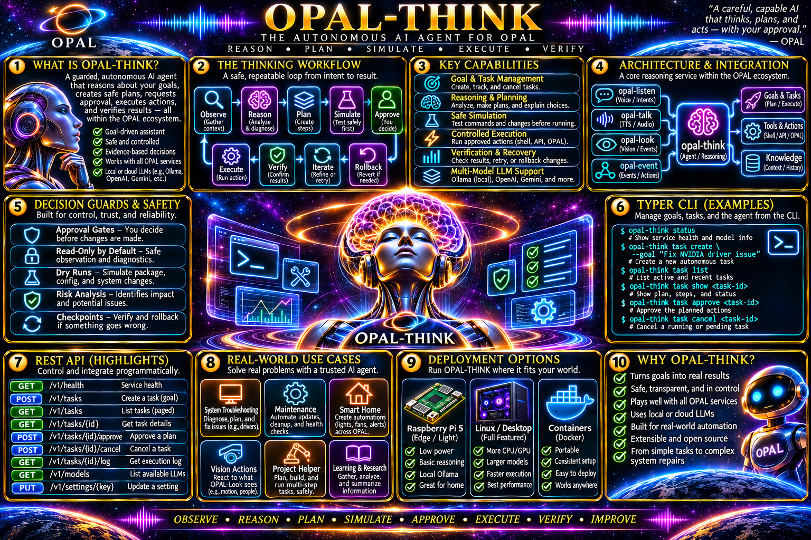

# OPAL Think
### Give OPAL a brain. Keep its hands on a leash.

A computer is acting strangely. Your camera noticed something unusual. A voice command needs a thoughtful answer. You want an assistant that can **reason about the problem**, show what it's doing, and—when carefully connected to approved tools—help do something useful.

**OPAL Think** is the guarded reasoning service for [OPAL](https://github.com/PatMartin/opal). It turns prompts into **trackable tasks**, connects to local Ollama models or an optional OpenAI-compatible API, keeps conversation context in sessions, streams responses as they arrive, and can route model-requested tool calls **only through registered OPAL Event actions**.

~~~text
   OPAL Listen         OPAL Look          Your app / CLI
   "What happened?"    "Person seen"      "Diagnose my GPU"
          │                 │                    │
          └─────────────────┼────────────────────┘
                            ▼
                        OPAL Think
                     Task + session API
                            │
                            ▼
                    Choose a model
                  ┌─────────┴─────────┐
                  ▼                   ▼
             Local Ollama         OpenAI API
                  └─────────┬─────────┘
                            ▼
                     Reason + respond
                            │
                      Tool requested?
                      /           \
                    No             Yes
                    │               │
                    │       Check enabled actions
                    │               │
                    │          OPAL Event
                    │       execute + observe
                    │               │
                    └───────┬───────┘
                            ▼
                    Answer + task history
                            │
                       OPAL Talk
                      "Here's why…"
~~~

The goal isn't to let an AI run whatever shell command comes to mind. It's to build a **useful, observable, bounded assistant** that separates reasoning from execution.

> **What is guarded today?** OPAL Think never executes model-generated shell, URL, or Python code directly. The only external action path is through an *enabled action already registered in OPAL Event*. It validates action IDs, limits steps and time, records action outcomes, and keeps read-only/model-only operation possible.
>
> **What isn't here yet?** A universal **simulate → risk-assess → human approve → execute → verify/rollback** workflow is part of the longer-term vision, **not an implemented approval gate** in this version. If Event exposes an enabled mutating action, a tool-capable model can request it without a separate user-confirmation step. Start with **read-only Event actions**.

## What makes it different?

- **Tasks are first-class resources.** Submit work, get a task ID, follow progress, inspect the answer, or cancel a long-running task.
- **Local inference first.** [Ollama](https://ollama.com/) is enabled by default; run your own downloaded models and keep basic reasoning local.
- **Optional external models.** An OpenAI adapter is available, disabled until explicitly configured with a credential *reference*, not a stored secret.
- **Built for the entire OPAL ecosystem.** Listen hears, Look sees, Event acts, Talk speaks; Think reasons and coordinates.
- **The model does not own the executor.** Think exposes only *enabled* Event actions as tools; it cannot create or reconfigure actions, rules, or settings through its Event client.
- **A session remembers your conversation.** Keep related prompts and completed answers together; one active task at a time per session.
- **Watch work in progress.** Task events and response text stream over Server-Sent Events (SSE), with an authoritative REST snapshot for the final result.
- **Safety limits aren't just a prompt.** Tasks have concurrency limits, bounded reasoning steps, deadlines, cooperative cancellation, and causation-chain protection.
- **Settings change one key at a time.** The Typer CLI uses strong ETags, so a stale update cannot silently overwrite a newer setting.
- **Evaluate it without spending model tokens.** Deterministic `fake:echo` and scripted evalsets exercise behavior, including forbidden actions that must never reach Event.
- **API-first all the way down.** FastAPI implements the contract; Typer and the bundled single-file SPA are HTTP clients, not duplicate engines.

**Today's code:** Python package **0.1.0** implementing the [OPAL Think 1.4.0 contract](opal_think.v1.4.0.yaml). Those are different version identifiers: implementation vs API contract.

## Installation

### 1. Install OPAL Think

Requires **Python 3.11+** and Git. These commands work in a Linux/macOS shell (including Ubuntu); adapt virtual-environment activation for Windows PowerShell.

~~~bash
git clone https://github.com/PatMartin/opal-think.git
cd opal-think

python3 -m venv .venv
source .venv/bin/activate
python -m pip install -e ".[dev]"
~~~

Installed commands:

| Command | Purpose |
| --- | --- |
| `opal-think-svc` | Run the FastAPI reasoning service |
| `opal think ...` | Unified OPAL Typer command group |
| `opal-think ...` | Standalone alias to the Think command group |

If several OPAL packages are installed in one virtual environment, the `opal` script can be owned by the last package installed. **Use `opal-think` in unattended scripts** when you need an unambiguous entry point. The commands below use `opal think` for consistency across OPAL.

### 2. Start the service

OPAL Think's code defaults to **port 8080**, which is also commonly used by OPAL Event. To run both services on the same machine, we'll put **Think on 18100** in this guide.

In terminal one:

~~~bash
opal-think-svc --host 127.0.0.1 --port 18100
~~~

In terminal two, from the repo with the virtual environment activated:

~~~bash
export OPAL_THINK_API_URL=http://127.0.0.1:18100

opal think health --live
opal think health
opal think settings list
~~~

| Interface | URL with the guide's port |
| --- | --- |
| Web console | `http://127.0.0.1:18100/` |
| REST API | `http://127.0.0.1:18100/api/v1/` |
| Interactive API docs | `http://127.0.0.1:18100/docs` |
| Health | `http://127.0.0.1:18100/api/v1/health/` |
| Authoritative contract file | [`opal_think.v1.4.0.yaml`](opal_think.v1.4.0.yaml) |

The browser UI is a **bundled single HTML application** served at `/`. No Node.js build is required to view it.

**Liveness vs readiness:** The process can be alive while it has no usable language model. `health --live` can succeed even when `health --ready` returns HTTP **503**. That's expected until a provider has an available model.

### 3. First run, with no Ollama or API key required

Want to check the whole API → task → answer path before configuring a language model? Enable the bundled **fake echo** provider. This is a deterministic development tool, **not AI reasoning**.

~~~bash
# Disable Ollama for the offline smoke test.
opal think settings set providers.ollama.enabled false

# Create an enabled fake provider via registered settings.
opal think settings set providers.fake.type fake
opal think settings set providers.fake.enabled true

# Discover the included test model.
opal think model list
opal think model show fake:echo

# Start a real task through the REST-backed CLI.
opal think ask "Hello OPAL, can you hear me?" --model fake:echo
~~~

Expected answer:

~~~text
echo: Hello OPAL, can you hear me?
~~~

Now you can explore the task log:

~~~bash
opal think task list
opal think health --ready
~~~

**Important:** `fake:script` is another advertised test model, but its responses are injected by the **test/evaluation harness**. It is not a useful standalone interactive model unless a test supplies its script.

### 4. Connect a local Ollama model for real reasoning

Install and start [Ollama](https://ollama.com/), then download a model. For example:

~~~bash
# Run only if Ollama isn't already running as a service:
# ollama serve

ollama pull llama3.2
ollama list
~~~

On the OPAL Think side, point the provider at the Ollama server and enable it:

~~~bash
opal think settings set providers.ollama.base_url http://127.0.0.1:11434
opal think settings set providers.ollama.enabled true

# The discovered ID must match what Ollama reports, including its tag.
opal think model list
opal think model show 'ollama:llama3.2:latest'

opal think ask \
  "Explain how event-driven systems differ from direct function calls." \
  --model 'ollama:llama3.2:latest'
~~~

If Ollama runs on another computer, replace the provider URL with that machine's reachable Ollama address. Keep the Ollama API on a trusted network; avoid exposing it publicly without protection.

### 5. Make it your default model (optional)

~~~bash
opal think settings set models.default_id 'ollama:llama3.2:latest'

# Once a default is set, the model flag is optional.
opal think ask "Give me three useful ideas for a Raspberry Pi assistant."
~~~

Use the exact model ID from `model list`, not a guessed short name. If no default is configured, Think automatically selects one available discovered model; this may not be the model you intended when several providers are enabled.

## Complete Typer command tree

This is the **implemented** command surface from [`src/opal_think/cli/main.py`](src/opal_think/cli/main.py). The same commands work with the `opal-think` alias—omit the `opal think` prefix when using it.

~~~text
opal
└── think                                        (alias: opal-think)
    │
    │  GLOBAL OPTIONS (put after "think", before command/group)
    │  --api-url URL                             [env OPAL_THINK_API_URL]
    │  --token TOKEN                             [env OPAL_THINK_API_TOKEN]
    │  --json                                    JSON output
    │  --timeout SECONDS                         HTTP timeout (default 30)
    │  --opal-session-id ID                      X-Opal-Session-Id
    │  --opal-transaction-id ID                  X-Opal-Transaction-Id
    │  --opal-causation-id ID                    X-Opal-Causation-Id
    │
    ├── health                                   [--live] [--ready]
    │
    ├── ask PROMPT                               [--model MODEL_ID]
    │                                            [--session-id SESSION_ID]
    │                                            [--stream/--no-stream]
    │
    ├── chat                                     [--model MODEL_ID]
    │                                            [--session-id SESSION_ID]
    │                                            [--stream/--no-stream]
    │
    ├── task
    │   ├── create PROMPT                        [--model MODEL_ID]
    │   │                                        [--session-id SESSION_ID]
    │   │                                        [--max-steps N]
    │   │                                        [--timeout SECONDS]
    │   │                                        [--detach]
    │   ├── list                                 [--status STATUS]
    │   │                                        [--session-id SESSION_ID]
    │   │                                        [--limit N] [--cursor TOKEN]
    │   ├── show TASK_ID
    │   ├── watch TASK_ID                        (SSE, then final snapshot)
    │   └── cancel TASK_ID                       (cooperative request)
    │
    ├── session
    │   ├── add                                  [--title TEXT]
    │   ├── list                                 [--limit N] [--cursor TOKEN]
    │   ├── show SESSION_ID
    │   └── remove SESSION_ID
    │
    ├── model
    │   ├── list
    │   └── show MODEL_ID
    │
    └── settings
        ├── list
        ├── show KEY
        ├── set KEY VALUE                        [--if-match ETAG]
        └── remove KEY                           [--if-match ETAG]

Service launcher (a separate command, not in the REST client tree):

opal-think-svc                                 [--config PATH]
                                               [--host HOST]
                                               [--port PORT]
~~~

No `task delete`, `model install`, `event rule add`, `approve`, or `evalset` CLI commands are implemented. Provider model installation belongs to the provider (for example, `ollama pull`), task deletion is deliberately absent, and evalsets run through pytest.

Learn options at any level:

~~~bash
opal think --help
opal think task --help
opal think task create --help
opal think settings set --help
opal-think --help
opal-think-svc --help
~~~

**Global option placement matters:** `opal think --json task list` requests JSON, while `opal think task list --json` is not a valid command. There are **two different timeout flags**: the global `--timeout` limits an HTTP request, while `task create --timeout` sets the task's execution deadline.

## In-depth CLI guide: make the brain useful

### The five ideas behind the CLI

| Concept | In plain English | Example |
| --- | --- | --- |
| **Provider** | Where inference runs | `ollama`, `openai`, `fake` |
| **Model** | Which actual language model answers | `ollama:llama3.2:latest` |
| **Task** | One bounded unit of reasoning | "Explain this error" |
| **Session** | A collection of related conversation turns | "Ubuntu repair investigation" |
| **Action** | An enabled, registered OPAL Event operation | A read-only diagnostics script |

A **task** has one prompt, a selected model, a deadline, a step limit, and a lifecycle. A **session** makes multiple tasks share recent completed conversation history. An **Event action** is not a native Think function: Event owns the implementation and authorization of the action.

### Use case 1: Ask a real model something interesting

~~~bash
opal think ask \
  "I have an Ubuntu workstation with a GPU. Explain what NVIDIA driver, kernel module, CUDA toolkit, and Ollama each do, and how they fit together." \
  --model 'ollama:llama3.2:latest'
~~~

By default, `ask` submits a task and watches its output over SSE, so text can appear while the model is generating. If you prefer to wait for a finished response:

~~~bash
opal think ask \
  "Compare polling and pub/sub for a small home-automation system." \
  --model 'ollama:llama3.2:latest' \
  --no-stream
~~~

This is **reasoning**, not a diagnostic scan. Unless you've connected suitable Event actions, the model has no direct access to the workstation's current system state and cannot honestly claim it inspected your GPU.

### Use case 2: Run a persistent troubleshooting conversation

Start a named session:

~~~bash
opal think session add --title "Ubuntu GPU investigation"
opal think session list
~~~

Copy the returned `session_id` and open chat:

~~~bash
opal think chat \
  --session-id YOUR_SESSION_ID \
  --model 'ollama:llama3.2:latest'
~~~

Example conversation:

~~~text
> Why might a new Linux kernel make NVIDIA disappear?
> Give me safe, read-only checks before suggesting driver changes.
> If nvidia-smi says "couldn't communicate with the NVIDIA driver", what evidence would narrow the possibilities?
> exit
~~~

Each turn is its own task linked to the same session. The engine supplies up to **10 prior completed prompt/answer pairs** to the next turn; it is not unbounded context memory.

To inspect the conversation container:

~~~bash
opal think session show YOUR_SESSION_ID
opal think task list --session-id YOUR_SESSION_ID
~~~

When no `--session-id` is provided, `chat` creates a new session automatically and prints its ID to stderr. Save that ID to resume later.

**Concurrency rule:** Two queued/running tasks cannot share a session at once. Trying to overlap them returns **409**. Wait for the first task to finish or request cancellation.

### Use case 3: Create background-style tasks you can inspect

By default, `task create` submits a request and polls until completion. With `--detach` it returns immediately after admission, leaving the server to process the task.

~~~bash
opal think task create \
  "Draft a practical checklist for diagnosing a home network outage without changing router settings." \
  --model 'ollama:llama3.2:latest' \
  --max-steps 5 \
  --timeout 180 \
  --detach
~~~

The CLI prints a `task_...` ID. You can inspect or follow it from another terminal:

~~~bash
opal think task show YOUR_TASK_ID
opal think task watch YOUR_TASK_ID
opal think task list --status running
opal think task list --status completed --limit 20
~~~

Task states:

~~~text
queued ──▶ running ──┬──▶ completed
                     ├──▶ failed
                     ├──▶ cancelled
                     └──▶ timed_out
~~~

When using `--detach`, the task runs in the **server process**. This is not a separate persistent worker service: tasks left active during a service restart are marked failed with a `service_restarted` error.

### Use case 4: Stop an investigation

~~~bash
opal think task cancel YOUR_TASK_ID
opal think task show YOUR_TASK_ID
~~~

Cancellation is **cooperative**. It sets `cancel_requested` and asks the runner to stop; it is not evidence that any external Event action has been rolled back. If the task has already reached a terminal state, cancellation returns **409**.

If a task has already asked Event to run an action, check the action's **Event execution record** separately. Think cancellation does not retroactively undo completed side effects.

### Use case 5: Use the smallest model that can do the job

Local models are especially useful for experimenting without paying per-token API fees.

~~~bash
# Check what's on the Ollama server.
ollama list

# Discover what Think actually sees.
opal think model list

# Inspect declared capabilities of an exact model ID.
opal think model show 'ollama:llama3.2:latest'
~~~

A discovered model advertises:

| Capability | Why you care |
| --- | --- |
| `streaming` | Can output response text progressively |
| `tool_calling` | Can request registered Event actions when connected |
| `structured_output` | May support constrained formats |
| `vision` | Model may accept image inputs at provider level |
| `context_window` | Approximate context available for prompts |

**Capability is not a completed feature.** OPAL Think's current `ask` and `task create` CLI commands accept **text prompts**, not a direct image attachment. Even if the provider reports `vision=true`, don't assume an image-upload CLI already exists.

Try an easier question with a lightweight model and reserve a stronger one for difficult reasoning:

~~~bash
opal think ask "Explain a Python dictionary in two sentences." \
  --model 'ollama:llama3.2:latest'

# Change the fallback model used by commands without --model:
opal think settings set models.default_id 'ollama:llama3.2:latest'
~~~

The adapter queries Ollama's actual tags and model details; model names are not hardcoded into the Think service.

### Use case 6: Tune task limits without editing code

~~~bash
opal think settings list
opal think settings show task.default_max_steps
opal think settings show task.max_steps_limit
opal think settings show task.max_concurrent

# Change one setting at a time.
opal think settings set task.default_max_steps 6
opal think settings set task.max_concurrent 2
opal think settings set task.default_timeout_seconds 90

# Restore the registered default of one key.
opal think settings remove task.max_concurrent
~~~

Useful defaults:

| Setting | Default | What it limits |
| --- | ---: | --- |
| `task.default_max_steps` | 8 | Steps for tasks without an override |
| `task.max_steps_limit` | 25 | Highest effective step count |
| `task.default_timeout_seconds` | 120 | Default task deadline |
| `task.timeout_limit_seconds` | 600 | Maximum configured task deadline |
| `task.max_concurrent` | 4 | Number of admitted active tasks |
| `task.max_causation_depth` | 8 | Depth of known Think task-to-task triggers |
| `task.retention_days` | 30 | Old terminal-task retention |
| `session.retention_days` | 30 | Inactive session retention |

A task's requested `max_steps` and `timeout_seconds` are **capped by service limits**. The CLI and API constrain values before task admission, and the server applies its own ceiling. Retention is swept **at service startup**; don't treat it as an always-running cleanup job.

### Use case 7: Turn an ordinary prompt into an evidence-first diagnostic plan

This is a safe use of the model **even with Event disconnected**:

~~~bash
opal think ask \
  "You are investigating an Ubuntu workstation where the NVIDIA GPU stopped working after an update. \
Provide: (1) competing hypotheses, (2) read-only commands to collect evidence, \
(3) what each command would prove or disprove, (4) risks of any proposed repair, \
and (5) a verification and rollback plan. Do not claim anything has been executed." \
  --model 'ollama:llama3.2:latest'
~~~

The result is a **reasoned plan**, not permission to execute it. You can review the suggested commands and compare them with actual evidence.

The longer-term OPAL Think vision is:

~~~text
Observe → Diagnose → Hypothesize → Gather evidence
            ↓
      Simulate / evaluate
            ↓
      Human approval gate
            ↓
    Execute → Verify → Roll back if needed
~~~

Today, the service implements **task orchestration and a guarded Event tool path**, not a full autonomous system-maintenance engine with simulated package operations, mutation approvals, or automatic rollbacks. Keep that distinction clear when building additional capabilities.

### Use case 8: Make a safe read-only tool available through OPAL Event

Suppose you registered an enabled **`gpu_diagnostics`** action in OPAL Event that runs a *read-only* diagnostic script. OPAL Think can discover that registered action and ask Event to execute it.

First, start [OPAL Event](https://github.com/PatMartin/opal-event) separately, and verify the action exists:

~~~bash
# Requires the separate OPAL Event package and service.
opal-event actions list
opal-event actions get gpu_diagnostics
~~~

**These commands do not create that action.** The example assumes you configured it in Event and restricted what it can do.

Tell Think where Event is:

~~~bash
# Our guide runs Think on port 18100 and Event on port 8080.
opal think settings set event.base_url http://127.0.0.1:8080

opal think health
opal think model show 'ollama:llama3.2:latest'
~~~

With a **tool-capable** model, ask for an evidence-backed check:

~~~bash
opal think task create \
  "If the enabled gpu_diagnostics tool is available, use it to inspect GPU status. \
Report only facts actually returned by the tool. Otherwise tell me what cannot be verified." \
  --model 'ollama:llama3.2:latest' \
  --max-steps 4 \
  --timeout 180
~~~

The guarded sequence is:

~~~text
Model requests action ID
          │
          ▼
Is it an enabled action returned by Event?
          │
      ┌───┴────┐
      │        │
      No      Yes
      │        │
 Refuse and    │
 record step   ▼
          POST Event /actions/{id}/execute
                        │
                 Poll execution status
                        │
                   Terminal result
                        │
                  Feed back to model
                        │
                    Final answer
~~~

This is *conditional*, not a guarantee a particular model will use a tool. If Event isn't configured, unavailable, or discovery fails, Think can continue in model-only mode; an attempted unlisted/disabled action is refused and not forwarded to Event.

**Crucial safety rule:** Don't enable broad shell, destructive, or otherwise mutating actions for a model until you have a separate, effective approval/authorization mechanism. Think does **not** stop to request human permission for an allowed action in the current release. Its Event client has only list/execute/status methods, but the downstream Event service must still enforce action permissions. Event 1.4.0's execute-only principal scoping is an outstanding integration dependency.

### Use case 9: Audit what the model actually did

Don't rely only on a friendly prose answer. Inspect the task:

~~~bash
opal think --json task show YOUR_TASK_ID
~~~

A task record includes its status, prompt, model ID, bounded `steps`, answer, error, timestamps, and cancellation state. An action step can include:

~~~json
{
  "kind": "action",
  "action_id": "gpu_diagnostics",
  "execution_id": "exec_123",
  "status": "succeeded",
  "summary": "action gpu_diagnostics succeeded"
}
~~~

That's an **illustrative subset**, not a literal full step schema. The actual step also includes index, timestamp, and sanitized input. Read the complete JSON to verify what happened.

If the step has `execution_id`, **OPAL Event** is the system of record for detailed execution logs. Think keeps a bounded summary, with secret-looking keys redacted and action input capped at 4 KiB. Unknown/forbidden action requests store no raw action-input object.

### Use case 10: Watch the live event stream as JSON

~~~bash
# Submit in one terminal.
opal think task create \
  "Write a short explanation of zero-copy networking." \
  --model 'ollama:llama3.2:latest' --detach

# Then follow it using its returned ID.
opal think --json task watch YOUR_TASK_ID
~~~

The stream consists of `task.started`, `task.progress`, `task.output`, `task.action`, and terminal events such as `task.completed` or `task.failed`. The CLI prints each JSON frame on its own line in JSON mode and then fetches a final task snapshot.

The live stream is **not a replayable audit log**. Slow consumers can lose intermediate frames; connecting after completion yields a terminal snapshot. Use `task show` for the authoritative final state and retained steps.

For an HTTP client, the underlying endpoint is:

~~~bash
curl -N -H 'Accept: text/event-stream' \
  http://127.0.0.1:18100/api/v1/tasks/YOUR_TASK_ID/stream
~~~

If bearer authentication is enabled, add the proper `Authorization: Bearer ...` header.

### Use case 11: Build a small task dashboard with jq

Everything the CLI shows comes from REST. With [`jq`](https://jqlang.github.io/jq/) installed:

~~~bash
# Human-readable task status and model choice.
opal think --json task list --limit 50 \
  | jq -r '.items[] | [.id, .status, .model_id] | @tsv'

# Tasks that failed (useful for debugging).
opal think --json task list --status failed \
  | jq -r '.items[] | [.id, (.error.message // "-")] | @tsv'

# Exact answer for a completed task.
opal think --json task show YOUR_TASK_ID \
  | jq -r '.answer // "(no answer stored)"'

# Current model catalog.
opal think --json model list \
  | jq -r '.[] | [.id, (.capabilities.tool_calling|tostring)] | @tsv'
~~~

Both tasks and sessions have **cursor pagination**. If a response contains `next_cursor`, pass it back with `--cursor` for the next page. Cursor strings are opaque, not page numbers.

### Use case 12: Use the REST API when the CLI doesn't expose a field

The task API accepts additional options such as `context`, `metadata`, and `Idempotency-Key`. The current Typer `task create` command does not expose all of these, so call REST directly when you need them.

For example, run a repeatable **fake-model** task with contextual details that are not part of the main prompt:

~~~bash
curl -sS -X POST http://127.0.0.1:18100/api/v1/tasks/ \
  -H 'Content-Type: application/json' \
  -H 'Idempotency-Key: demo-check-001' \
  -d '{
    "prompt": "Summarize the issue.",
    "model_id": "fake:echo",
    "context": {
      "component": "GPU",
      "observation": "nvidia-smi unavailable"
    },
    "metadata": {
      "demo": "readme",
      "ticket": "gpu-001"
    }
  }'
~~~

The API replies **202 Accepted** with the task snapshot and a `Location` header. Repeating the same request body with the same idempotency key returns the **same task**. Reusing the key with a different body returns **409**.

`metadata` is stored for tracking but **not passed to the model**. `context` is explicitly introduced to the model as *untrusted caller-supplied context*. Do not place credentials or private secrets in either.

For a new task without a session, you can omit `session_id` entirely. If you provide one, the session must already exist.

### Use case 13: Compare Ollama with OpenAI when you need a second opinion

The OpenAI provider is **disabled by default**. Use a server-side environment variable for the key and store only a reference:

~~~bash
# In the SERVICE's environment before starting or restarting the service:
export OPENAI_API_KEY='YOUR_API_KEY'

# In the CLI terminal, using the running Think service:
opal think settings set providers.openai.credential_ref env:OPENAI_API_KEY
opal think settings set providers.openai.enabled true

opal think model list
~~~

Choose an **actual ID from that list**:

~~~bash
opal think ask \
  "Review this proposed architecture. Find the three most important failure modes." \
  --model 'openai:YOUR_DISCOVERED_MODEL_ID'
~~~

Replace the placeholder with a real model ID returned by the catalog. The current adapter uses OpenAI's **model listing** and **chat-completions** endpoints; provider support may vary by model, account, and API compatibility.

> For reliable results, set the API key in the environment of the **running server process** (and restart if it wasn't present at launch), not merely in the CLI shell. Secret settings store references of the form `env:OPENAI_API_KEY` or `ENV_VAR_NAME`; they do not store raw API keys.

When finished experimenting, disable OpenAI:

~~~bash
opal think settings set providers.openai.enabled false
~~~

### Use case 14: Protect updates from accidental overwrites

~~~bash
opal think settings show task.max_concurrent

# The CLI normally retrieves the current strong ETag automatically.
opal think settings set task.max_concurrent 3

# Remove only the override; the registered default returns.
opal think settings remove task.max_concurrent
~~~

For callers that coordinate settings across processes, use `--if-match` with a previously obtained ETag. A stale ETag returns HTTP **412** rather than overwriting someone else's change. Missing preconditions on raw REST writes return **428**.

Settings support atomic multi-key REST patches, but the Think CLI deliberately keeps ordinary edits **single-key**. Use the [contract](opal_think.v1.4.0.yaml) for the collection PATCH schema if you need a coordinated batch.

### Use case 15: Guard against accidental repeated triggers

An agent that calls another agent, which calls the first, can loop. Think observes `X-Opal-Causation-Id` and bounds the depth of **Think-owned task ancestry**.

~~~bash
opal think settings show task.max_causation_depth

# Supply OPAL correlation headers on a CLI request:
opal think --opal-session-id demo-conversation \
  --opal-transaction-id gpu-diagnosis-001 \
  ask "Explain what these identifiers are useful for." --model fake:echo
~~~

The correlation headers are for tracing, **not authorization**. The causation depth bound is limited to ancestors visible in Think's own task store; loops that travel through unrelated services are not fully observable here. Keep cross-service loop protection in the other OPAL services too.

### Use case 16: Test safety decisions without a model or an actual executor

The repository contains deterministic, YAML-driven evalsets:

~~~text
evalsets/
├── model_only.yaml     # basic model-only completion
└── action_guard.yaml   # allowed, denied, failed action flows
~~~

Run them:

~~~bash
pytest tests/eval

# Entire Python test suite:
pytest

# Static checks:
ruff check .
~~~

These tests feed scripted responses into the `fake:script` adapter and use a **FakeEventClient**. They assert not just the answer but which action IDs were sent—or, for forbidden actions, that **no call reached Event**.

A representative safety test asserts:

~~~text
Proposed model action: remove_gpu_driver
Enabled Event catalog: gpu_diagnostics only
Expected:
  → refuse the unregistered action
  → record a failed action step
  → send ZERO execution requests to Event
~~~

That's a meaningful property to regression-test as new model adapters and actions are added. The evalsets run from **pytest**, not a `opal think evalset` CLI command, because the contract intentionally has no evalset management REST API.

## Configuration and deployment

### Provider and service settings live in different places

Think separates **process configuration** from **portable REST settings**.

- **Process settings** choose the bind address/port, SQLite path, and REST bearer authentication. They come from defaults, an optional YAML file, and environment overrides. Restart the service for these.
- **Portable settings** choose models, provider endpoints and enablement, Event connection, task limits, and retention. They are stored in SQLite, updated via REST, and generally effective immediately.

A minimal local service configuration:

~~~yaml
# example: think-server.yaml
server:
  host: 127.0.0.1
  port: 18100
db_path: var/think.db
auth:
  enabled: false
~~~

Start it with:

~~~bash
opal-think-svc --config ./think-server.yaml
~~~

Relevant process-level environment variables:

| Variable | Default | Meaning |
| --- | --- | --- |
| `OPAL_THINK_CONFIG` | none | Optional YAML configuration file |
| `OPAL_THINK_HOST` | `127.0.0.1` | REST bind address |
| `OPAL_THINK_PORT` | `8080` | REST bind port |
| `OPAL_THINK_API_URL` | `http://127.0.0.1:8080` | CLI's target service |
| `OPAL_THINK_API_TOKEN` | none | CLI bearer token; also default service token env ref |
| `OPAL_SESSION_ID` | none | Optional correlation session ID |
| `OPAL_TRANSACTION_ID` | none | Optional correlation transaction ID |
| `OPAL_CAUSATION_ID` | none | Optional correlation causation ID |

The default SQLite database is `var/think.db`; task and settings tables are created as needed.

### Security defaults

**Loopback is the default.** Binding the service to a non-loopback interface without configured bearer authentication is **rejected at startup**.

For a remote deployment, configure auth and provide a server-side token:

~~~yaml
# example: think-remote.yaml
server:
  host: 0.0.0.0
  port: 18100
auth:
  enabled: true
  token_env: OPAL_THINK_API_TOKEN
~~~

~~~bash
# Set in the environment that starts the server; use your own strong secret.
export OPAL_THINK_API_TOKEN='REPLACE_WITH_A_LONG_RANDOM_SECRET'
opal-think-svc --config ./think-remote.yaml
~~~

On a trusted client, set `OPAL_THINK_API_URL` and `OPAL_THINK_API_TOKEN` to connect. Bearer auth protects REST endpoints but **does not itself encrypt traffic**. Use TLS and appropriate network controls for connections beyond localhost.

The bundled SPA uses browser `EventSource` for live output; that API cannot attach a custom Authorization header. Its streaming UX therefore works most directly on the loopback/no-auth development setup. Plan a reverse proxy/session-aware frontend design if you need protected remote browser streaming.

## Architecture and safety boundaries

~~~text
       Typer CLI                     Single-file SPA
       (HTTPX)                          (browser)
          └──────────────┬───────────────┘
                         ▼
                  FastAPI REST API
                   /api/v1/* only
                         │
          ┌──────────────┼──────────────────┐
          ▼              ▼                  ▼
     Task engine     SQLite store      Provider registry
     async runner   tasks/sessions     Ollama / OpenAI
          │         settings/ETags     fake for tests
          ▼                                  │
       Reason ◀──────────────────────────────┘
          │
          ▼
     Tool requested? ──▶ validate action ID ──▶ Event REST
          │                                        │
          │                             execute / poll result
          └──────────────────────◀─────────────────┘
          │
          ▼
     final answer + bounded history + SSE
~~~

### API-first contract

The canonical specification is [`opal_think.v1.4.0.yaml`](opal_think.v1.4.0.yaml); a packaged copy in [`src/opal_think/contract/opal_think.yaml`](src/opal_think/contract/opal_think.yaml) is tested to match it.

| REST operation family | CLI |
| --- | --- |
| `POST /api/v1/tasks/` | `task create`, `ask`, `chat` |
| `GET /api/v1/tasks/` | `task list` |
| `GET /api/v1/tasks/{id}` | `task show` |
| `GET /api/v1/tasks/{id}/stream` | `task watch`, `ask --stream` |
| `POST /api/v1/tasks/{id}/cancel` | `task cancel` |
| `POST/GET /api/v1/sessions/` | `session add/list` |
| `GET/DELETE /api/v1/sessions/{id}` | `session show/remove` |
| `GET /api/v1/models/*` | `model list/show` |
| `GET/PUT/DELETE /api/v1/settings/{key}` | `settings show/set/remove` |
| `GET/PATCH /api/v1/settings/` | `settings list`; PATCH currently REST only |
| `GET /api/v1/health/*` | `health`, `--live`, `--ready` |

No task DELETE endpoint is provided. Sessions can be removed, and removing a session **also removes its retained linked tasks** once no tasks in it are active.

### Guardrails in practical terms

| Boundary | What Think enforces | What it does **not** guarantee |
| --- | --- | --- |
| Action invocation | Only currently enabled catalog action IDs are allowed | An allowed action is automatically safe |
| Execution | Routes tool calls through Event API | Human approval before each action |
| Action result | Polls Event execution until terminal | Automatic rollback of side effects |
| Step limits | Bounded reasoning loop and max four tool requests per step | Correctness of the model's reasoning |
| Timeout/cancel | Deadline checks and cooperative cancellation | Revoking an already-running external action |
| Context | Session and correlation tracking | Global visibility of every cross-service hop |
| Logs | Redacted, bounded step input and final status | A full durable Event execution log |
| SSE | Progressive task events | Replay of every previously emitted event |
| Secrets | Environment references for provider/Event credentials | Protection if server environment is compromised |

This is why **read-only diagnostics** are the best early use case: a model can collect real evidence from deliberately harmless actions without being given free rein over the operating system.

### Model-only mode is a feature, not a failure

Leave `event.base_url` unset to run Think as a pure reasoning service. It can explain, draft, review, and plan without an action backend. Readiness depends on **available models**, not on Event reachability; an unavailable configured Event service can degrade health without making normal model-only answers impossible.

To return to model-only mode:

~~~bash
opal think settings remove event.base_url
opal think health
~~~

### Retention, restart, and history

- Task states are persisted to SQLite, including answer, error, bounded steps, timestamps, and optional metadata.
- Sessions hold recent completed conversation turns, not a permanent unlimited model context.
- On startup, old terminal tasks and idle sessions are swept according to configured retention. Deleting/expiring a session can cascade to its task history.
- If the service restarts with a queued/running task, the task is marked **failed**, not silently resumed.
- SSE task streams are **live-only**. Poll `task show` for the final record.

## Troubleshooting

| Symptom | Check |
| --- | --- |
| `health --live` works, `health --ready` fails | No usable model; start Ollama, download a model, or enable `fake:echo` for testing |
| `model list` returns 503 | All enabled providers are unreachable; inspect provider base URLs and enablement |
| Model name rejected | Use exact ID, including `provider:` and any Ollama model tag |
| Think and Event compete for port 8080 | Run Think on 18100 as shown above |
| `ask` returns 503 | Model/provider unavailable or no model configured |
| Task returns 429 | Concurrency cap reached |
| Session task returns 409 | Another task is queued/running in the same session |
| `task watch` missed intermediate text | SSE is live-only; use `task show` for the authoritative snapshot |
| Action wasn't executed | Confirm Event connected, action enabled, and model supports tool calling |
| An action returned failed | Inspect the linked execution in OPAL Event |
| Can't set a setting | Check registered key, JSON type, validation range, or ETag |
| Remote server refuses startup | Enable bearer auth before a non-loopback bind |
| Browser stream fails under auth | Native EventSource can't supply your bearer header |
| Completed task missing after a while | Check retention and whether its session was removed |

## Development and evaluations

~~~bash
# Install development dependencies if needed:
python -m pip install -e ".[dev]"

# Unit, contract, client, and integration tests:
pytest

# Fast deterministic action-policy evaluations:
pytest tests/eval

# Lint:
ruff check .

# Optional live Ollama integration tests:
OPAL_THINK_LIVE_OLLAMA=http://127.0.0.1:11434 \
OPAL_THINK_LIVE_MODEL=llama3.2:latest \
pytest tests/integration
~~~

The live Ollama tests are opt-in and require a reachable provider and installed model. The normal deterministic suite does not need external API keys or Event itself.

### Repository map

~~~text
opal-think/
├── opal-think.png                      project graphic
├── README.md                           this guide
├── AGENTS.md                           contributor conventions
├── opal_think.v1.4.0.yaml              authoritative OpenAPI contract
├── pyproject.toml                      Python package / CLI entry points
├── evalsets/
│   ├── model_only.yaml                deterministic completion checks
│   └── action_guard.yaml              allowed / blocked tool scenarios
├── src/opal_think/
│   ├── __main__.py                     server launcher
│   ├── app.py                          FastAPI app and middleware
│   ├── cli/
│   │   ├── main.py                    Typer command tree
│   │   └── client.py                  HTTPX REST client
│   ├── engine.py                       task admission, runner, tool loop
│   ├── event_client.py                 Event execute-only REST adapter
│   ├── providers/
│   │   ├── registry.py                provider discovery/config
│   │   ├── ollama.py                  local Ollama adapter
│   │   ├── openai.py                  OpenAI adapter
│   │   └── fake.py                    test and eval adapter
│   ├── settings_registry.py            defaults, validation, ETags
│   ├── store.py                        SQLite task/session storage
│   ├── opal_context.py                 correlation middleware
│   ├── routers/                        tasks/sessions/models/settings/health
│   ├── contract/opal_think.yaml         packaged contract
│   └── spa/index.html                  standalone browser console
└── tests/
    ├── client/                         CLI vs REST tests
    ├── contract/                       behavior + error/contract tests
    ├── eval/                           YAML evalset runner
    ├── integration/                    optional live-provider tests
    └── unit/                           providers, settings, storage, guards
~~~

---

**OPAL Think isn't an excuse to hand a language model the root password.** It's a way to build an assistant that can think, explain, ask the right questions, and—through deliberately constrained tools—help produce real results.

Start in model-only mode. Add one trusted, read-only Event action. Test the failure cases. Then grow toward a truly guarded autonomous system—one evidence-backed, reviewable step at a time.

[Explore OPAL](https://github.com/PatMartin/opal) · [OPAL Listen](https://github.com/PatMartin/opal-listen) · [OPAL Look](https://github.com/PatMartin/opal-look) · [OPAL Event](https://github.com/PatMartin/opal-event) · [OPAL Talk](https://github.com/PatMartin/opal-talk)
